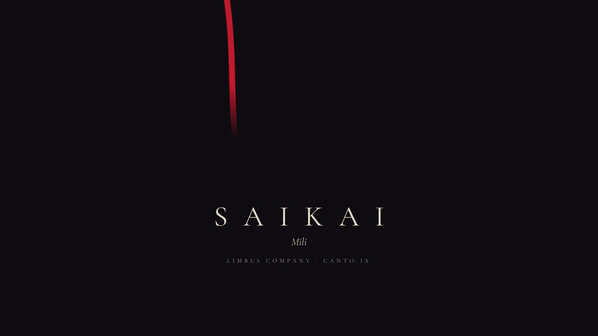
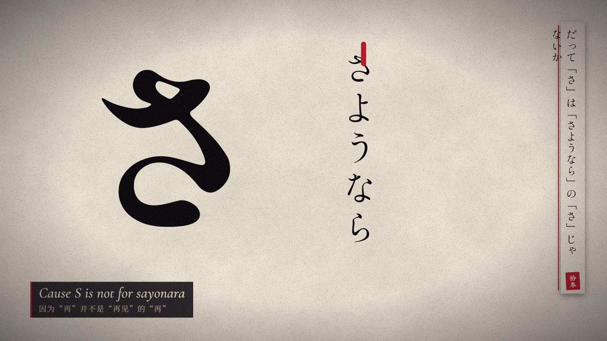
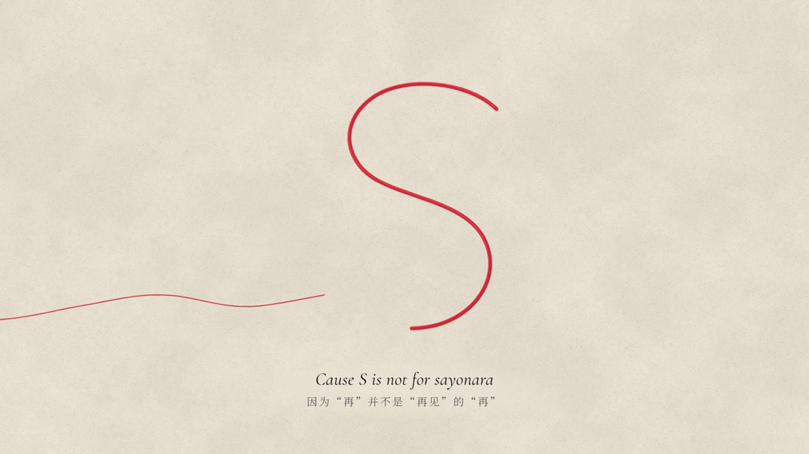
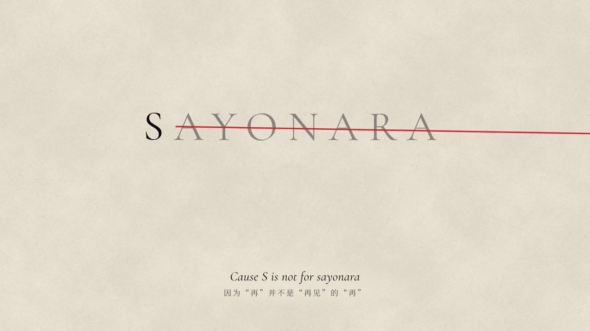
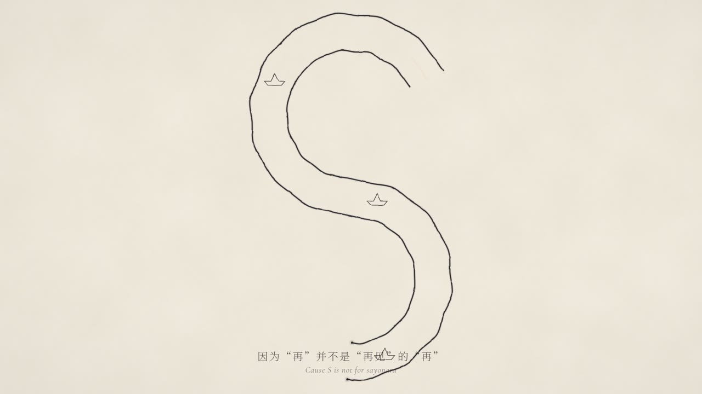

# SAIKAI: an AI-agent-produced music video



A 5:24, 1080p fan music video for Mili's *SAIKAI*, set to Canto IX of *Limbus Company* (Ryoshu and her daughter Araya). I directed it and designed the production pipeline. An AI coding agent (Claude Code) wrote and ran the code. It took 6 days (Oct 21–26, 2026) and went through 4 major versions plus a separate original-art cut.

**Watch:** [YouTube](https://youtu.be/bYeoAW-4gAc) · [bilibili](https://www.bilibili.com/video/BV12Hn96JEX5/)

## My role

- **Director and art director.** I set the visual language, the color rules and the shot-by-shot direction, reviewed every cut frame by frame, and made the keep/cut calls.
- **Pipeline designer.** I chose the tool chain and how the work was split between the cloud agent and my own machine (GPU and API-key work stayed local).
- **Rule-keeper.** After v3 I wrote the review feedback into two documents: a *brief* (creative rules) and a *spec* (hard rules, decisions, project structure). Every later change was checked against them.

The code in this repo was written by the agent under my direction. I'm sharing it to show the pipeline, not as hand-written code.

## Pipeline

| Stage | Tools | What it produced |
|---|---|---|
| Research | Game's local script files (JP/KR/EN/CN) | Character notes and checked lore details (e.g. which symbols belong to which character) |
| Audio and timing | Vocal separation, Whisper | Lyric timings for 33 lines; one `cues.ts` file for every non-lyric timestamp |
| Rules | Markdown brief and spec | One visual language (paper-cut print), a fixed color table, a list of what to cut |
| Stills | gpt-image (edits API), Python/PIL | Faceless character silhouettes, recolored to the film's palette |
| 3D | Blender (flat emissive materials and Freestyle outlines) | Paper-look 3D: folding screen, safe, picture book, rooftop |
| Compositing | Remotion (React/TypeScript) | 30 shots rendered frame by frame against the song |
| Review loop | ffmpeg, contact sheets | 60+ short section previews, each named by shot and timestamp |
| Delivery | Chunked transfer and md5 check | Final 1920×1080, 30 fps, 9,718 frames |

## How it evolved

All frames are at 1:48.8 ("Cause S is not for sayonara").

| v1: halftone print | v2: line art |
|---|---|
|  |  |
| **v3: color-block silhouettes** | **v4: paper-cut print (final)** |
|  |  |

**Original-art cut** (no source-game assets; one-stroke ink lines on washi paper):



| Version | Main problem in review | What changed next |
|---|---|---|
| v1 | Subtitles came in before the vocals; generated characters looked random | Line-art take built from official art |
| v2 | Official art has one standing pose, so it looked pasted into scenes | Generated poses, outline only |
| v3 | Distorted bodies; three different art styles mixed together | Stopped and wrote the brief before touching code |
| v4 | Pacing and physics of single shots | Shot-by-shot polishing (one shot took 36 previews) |

Full contact sheets: [v4](media/v4_contact_sheet.jpg) · [original cut](media/original_contact_sheet.jpg)

## Things I learned

1. **Rules beat more pictures.** v1–v3 kept repeating the same mistakes. Breaking down a reference MV showed that what makes it work is strict, consistent rules about what each element means. Writing those rules down first is what made v4 the version I liked.
2. **Turn vague feelings into specific changes.** The opening yarn ball took 36 previews. "It feels jerky" turned out not to be dropped frames: the ball's rise and its spin were cancelling each other out. The fix was to spin the ball, keep the thread still, and use linear acceleration.
3. **Limit what AI generates.** There are only three full characters in the film, all faceless flat silhouettes. Props that must look the same in every shot (the sword and sheath) are drawn in code, not generated.

## Working documents

These are the two rule documents behind v4, kept as they were used during production (in Chinese):

- [`docs/SAIKAI_v4_brief.md`](docs/SAIKAI_v4_brief.md): the creative brief. It covers who has the final say, one visual language, the color table ("color is the character"), rules for characters, thread, text and pacing, the motif-and-callback table, section-by-section direction, and a running list of where the build departed from the brief and why.
- [`docs/SAIKAI_v4_spec.md`](docs/SAIKAI_v4_spec.md): the handoff spec for the agent. It covers hard rules, decisions already made, project structure, technical notes and a dated progress log.

## Repo layout

```
code/
  package.json, remotion.config.ts   shared Remotion setup
  v4/                                final version
    src/        Remotion project: shots/ (A–D), comp/ (paper-cut prop library), timeline.ts, cues.ts
    blender/    Blender scene scripts and the shared flat-material + Freestyle setup
    tools/      Python helpers for compositing character layers and image sequences
    gen/r3–r7/  gpt-image scripts, one folder per round (key read from the environment, never stored)
  original/     the original-art cut (Remotion + Python)
docs/           creative brief and production spec (Chinese)
media/          stills and contact sheets
```

**Not included:** the song, the lyrics text, game assets, fonts, generated images and rendered video, because they are copyrighted or too large. The code won't render without them; it's here to be read.

## Credits

Music: *SAIKAI* by Mili. Story and characters: *Limbus Company* by Project Moon. This is a non-commercial fan work.
